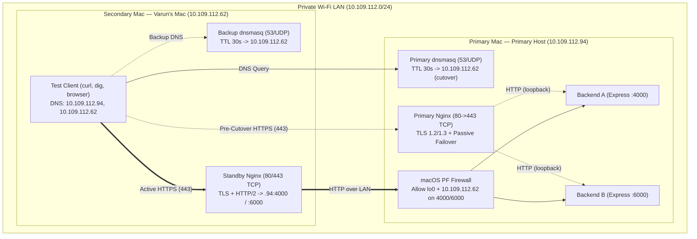

# Private Network Service Platform

A locally hosted, two-Mac Computer Networks project implementing private DNS resolution, TLS termination, reverse proxying, round-robin load balancing, HTTP caching, host firewall isolation, and Phase 2 high-availability failover over a shared Wi-Fi LAN.

---

## Features

### Phase 1 — Core Network Stack
- **Private DNS (`dnsmasq`)**: Resolves `app.team1.test` and `api.team1.test` locally on UDP port `53` (using `.test` to avoid macOS `.local` mDNS conflicts).
- **HTTPS Edge & TLS Termination (`nginx`)**: Redirects HTTP (`80`) to HTTPS (`443`), terminates TLS 1.2 / 1.3 with HTTP/2 using a project-local Root CA certificate (`CN_Project Local Root CA`).
- **Round-Robin Load Balancing**: Distributes traffic across two Express.js backends (`X-Backend: A` and `X-Backend: B`) with passive upstream health checks.
- **HTTP Caching**: `/api/cached` demonstrates `Cache-Control: public, max-age=60`, `ETag: "v1"`, and conditional `304 Not Modified` responses.
- **Packet-Level Evidence**: Captured in Wireshark (`evidence/phase-1/`).

### Phase 2 — Resilience, Isolation & Failover
- **Backup DNS Resolver**: Secondary `dnsmasq` on `10.109.112.62` provides automatic failover when Primary DNS (`10.109.112.94`) stops.
- **30-Second DNS TTL**: Configured via `local-ttl=30` for controlled cutover windows.
- **Standby Nginx Edge**: Standby HTTPS reverse proxy on `10.109.112.62` serving both backends over the LAN (`8/8` HTTPS test: `4` Backend A, `4` Backend B).
- **Service Isolation (macOS PF)**: Host firewall anchor on `10.109.112.94` restricts inbound TCP `4000` and `6000` to loopback and `10.109.112.62`.
- **Verified Failure Modes**: Single-backend failover, dual-backend `502 Bad Gateway` + recovery, primary DNS failover, and standby edge cutover.

---

## Architecture



See [docs/architecture.md](docs/architecture.md) for the full component breakdown, protocol layer mapping, and request sequence diagrams.

---

## Technologies Used

- **Express.js (`^5.2.1`) / Node.js**: Lightweight REST backends (`backendA` & `backendB`)
- **Nginx**: Reverse proxy, TLS termination, HTTP/2, and round-robin load balancing
- **dnsmasq**: Private DNS resolution and upstream forwarding
- **OpenSSL**: Local Root CA and SAN server certificate generation
- **macOS PF (`pfctl`)**: Host-level TCP port isolation for backend services
- **curl, dig, nc, Wireshark**: Verification, diagnostics, and packet inspection

---

## Project Structure

```text
.
├── backendA/                          # Express Backend A (port 4000)
│   ├── package.json
│   └── server.js
├── backendB/                          # Express Backend B (port 6000)
│   ├── package.json
│   └── server.js
├── certs/                             # Public CA cert (rootCA.pem) & server cert (app.pem); private keys excluded
├── configs/                           # Clean Phase 1 & Phase 2 configuration bundle
│   ├── README.md
│   ├── dnsmasq/
│   │   ├── primary-dnsmasq.conf       # Primary Mac dnsmasq config
│   │   ├── backup-dnsmasq.conf        # Secondary Mac backup dnsmasq config
│   │   └── dnsmasq.conf               # Historical Phase 1 failure-demo artifact
│   ├── nginx/
│   │   ├── primary-nginx.conf         # Primary Nginx HTTPS & LB config
│   │   ├── standby-nginx.conf         # Standby Nginx config on Secondary Mac
│   │   └── team1.conf                 # Historical Phase 1 Nginx config
│   └── pf/
│       ├── cn_project.anchor.conf     # macOS PF anchor rules for ports 4000/6000
│       └── README.md                  # PF installation, verification & rollback steps
├── docs/
│   ├── architecture.md                # Full two-Mac system architecture & diagrams
│   ├── setup-and-configuration.md     # End-to-end setup, startup & troubleshooting guide
│   └── topology.png                   # Phase 1 topology diagram
├── evidence/                          # Phase 1 screenshots, Wireshark captures & failure evidence
│   └── README.md
├── phase2_report/
│   ├── phase2-report.tex              # IEEE-format LaTeX Phase 2 engineering report
│   ├── phase2-report.pdf              # Compiled two-column IEEE Phase 2 report PDF
│   └── phase2-report.md               # Markdown Phase 2 report & verified test-results table
├── presentation/
│   ├── CN_Project_Final_Presentation.pdf   # 12-slide final project presentation (PDF)
│   ├── CN_Project_Final_Presentation.pptx  # Source PowerPoint deck
│   └── slides-outline.md
└── README.md
```

---

## Setup Instructions

Full step-by-step commands are in [docs/setup-and-configuration.md](docs/setup-and-configuration.md). Summary below:

### 1. Run Both Backends (Primary Mac: `10.109.112.94`)

```sh
# Terminal 1
cd backendA && npm install && npm start

# Terminal 2
cd backendB && npm install && npm start
```

- **Endpoints**: `/` (plain text), `/api/data` (JSON), `/api/status` (`Cache-Control: no-store`), `/api/cached` (`Cache-Control: public, max-age=60`, `ETag: "v1"`).
- **Important**: The committed `server.js` files bind to `127.0.0.1` (Phase 1). For Phase 2 Standby Nginx across Macs, bind both running backends on `10.109.112.94` to `0.0.0.0` alongside the PF firewall rules.

### 2. DNS & Nginx Setup

- **Primary Mac (`10.109.112.94`)**: Deploy [configs/dnsmasq/primary-dnsmasq.conf](configs/dnsmasq/primary-dnsmasq.conf) and [configs/nginx/primary-nginx.conf](configs/nginx/primary-nginx.conf).
- **Secondary Mac (`10.109.112.62`)**: Deploy [configs/dnsmasq/backup-dnsmasq.conf](configs/dnsmasq/backup-dnsmasq.conf) and [configs/nginx/standby-nginx.conf](configs/nginx/standby-nginx.conf).
- **Client DNS Order**: Set DNS servers to `10.109.112.94` (primary), then `10.109.112.62` (backup).

### 3. HTTPS Certificate Trust

Install [certs/rootCA.pem](certs/rootCA.pem) into the client macOS System Keychain (`Always Trust`):

```sh
sudo security add-trusted-cert -d -r trustRoot -k /Library/Keychains/System.keychain certs/rootCA.pem
```

Copy `app-key.pem` out-of-band to each Nginx host (`chmod 600`); private keys are never committed to Git.

### 4. PF Firewall Setup (Primary Mac)

Load [configs/pf/cn_project.anchor.conf](configs/pf/cn_project.anchor.conf) following [configs/pf/README.md](configs/pf/README.md) so only loopback and `10.109.112.62` can reach TCP ports `4000` and `6000`.

---

## Testing Commands

```sh
# DNS checks
dig @10.109.112.94 app.team1.test
dig @10.109.112.62 api.team1.test

# Trusted HTTPS request (no -k flag)
curl -i https://app.team1.test/api/data

# Round-robin load balancing check (8 requests)
for i in {1..8}; do curl -sI https://app.team1.test/api/data | grep -i x-backend; done

# Conditional HTTP caching (304 Not Modified)
curl -i -H 'If-None-Match: "v1"' https://app.team1.test/api/cached
```

---

## Phase 2 Summary and Known Limitations

All verified Phase 2 tests and unverified items are recorded in [phase2_report/phase2-report.tex](phase2_report/phase2-report.tex) ([PDF](phase2_report/phase2-report.pdf) / [Markdown](phase2_report/phase2-report.md)):

- **Verified Highlights**: Backup DNS failover, `local-ttl=30` configuration, single-backend failover & recovery, both-backends-down `502 Bad Gateway` + `200 OK` recovery, PF rule loading & `10.109.112.62` backend reachability, and Standby Nginx cutover serving `8/8` HTTPS requests (`4` Backend A, `4` Backend B).
- **Not Yet Verified**: Live DNS record-change + manual client-side cache-flush observation, and direct PF port-block verification from an independent third LAN host.
- **Known Limitations**:
  1. **Process-level backend redundancy only**: Both Backend A and Backend B run on the Primary Mac (`10.109.112.94`), so backend failover protects against process crashes rather than full Primary Mac machine failure.
  2. **Host-IP PF scope**: PF rules allow any process originating from `10.109.112.62` to reach ports `4000`/`6000`, not exclusively the Nginx process.
  3. **Manual cutover**: DNS updates between `.94` and `.62` are performed manually.
