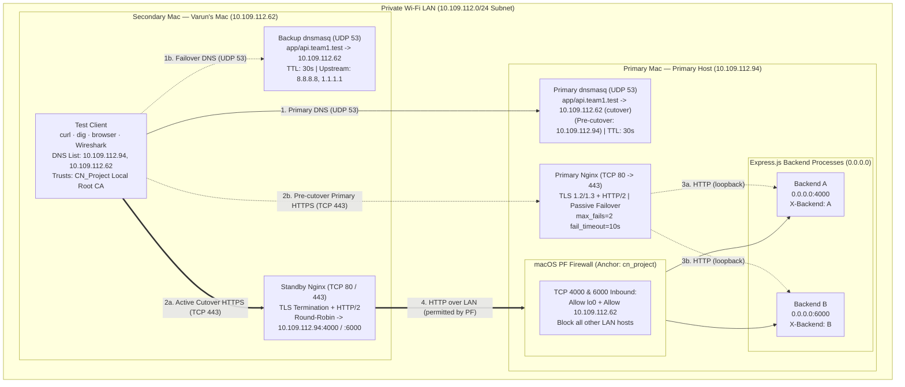
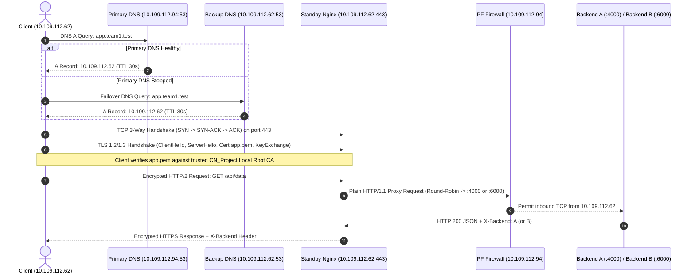

# System Architecture — Private Network Service Platform

## 1. Project Overview and Objectives

The **Private Network Service Platform** is a locally hosted, two-machine Computer Networks system built on macOS over a shared private Wi-Fi LAN. Rather than relying on cloud infrastructure, every network layer—private DNS resolution, TLS termination, reverse proxying, load balancing, HTTP caching, host firewall isolation, and high-availability failover—is implemented and observed directly across two MacBooks.

### Core Objectives

- **Phase 1 (Build & Observe)**: Implement a complete request pipeline (`DNS -> TCP -> TLS -> HTTP -> Backend`) using private `.test` domain names (`app.team1.test`, `api.team1.test`), a local Certificate Authority, Nginx reverse proxy with round-robin load balancing, two Express.js REST backends, and packet-level verification with Wireshark and `curl`.
- **Phase 2 (Harden & Recover)**: Eliminate single points of failure at the DNS and Edge proxy layers by introducing a **Backup DNS resolver** (`dnsmasq`), **30-second DNS TTL**, **Standby Nginx reverse proxy** on the Secondary Mac, **passive upstream health checks**, and **macOS PF firewall isolation** protecting backend ports.

---

## 2. Two-Mac System Architecture Diagram

The diagram below depicts the full Phase 2 two-Mac architecture, showing both the primary path and the DNS/Standby Nginx failover topology.

---

## 3. Network Topology and IP Address Allocation

Both Macs connect to the same private Wi-Fi hotspot/LAN segment.

| Host / Role | Owner | Private IPv4 | Services Hosted | Listening Ports & Scope |
| --- | --- | --- | --- | --- |
| **Primary Mac** | Primary Host | `10.109.112.94` | Primary `dnsmasq`, Primary `nginx`, macOS `pf` firewall, Backend A, Backend B | `53/UDP` (`127.0.0.1`, `10.109.112.94`), `80/TCP`, `443/TCP` (`0.0.0.0`), `4000/TCP` (`0.0.0.0`*), `6000/TCP` (`0.0.0.0`*) |
| **Secondary Mac** | Varun's Mac | `10.109.112.62` | Backup `dnsmasq`, Standby `nginx`, Client tools (`curl`, `dig`, browser) | `53/UDP` (`127.0.0.1`, `10.109.112.62`), `80/TCP`, `443/TCP` (`0.0.0.0`) |

*\*Repository code note: Committed [backendA/server.js](../backendA/server.js) and [backendB/server.js](../backendB/server.js) show the Phase 1 loopback binding (`127.0.0.1`). For Phase 2 Standby Nginx testing across machines, the live backend processes on the Primary Mac bind to `0.0.0.0` (`4000` and `6000`), protected by the PF firewall.*

### Service-to-Cloud Equivalence

| Local Component | Protocol / Port | Cloud Equivalent |
| --- | --- | --- |
| `dnsmasq` (Primary & Backup) | DNS (`53/UDP`) | Managed Authoritative DNS (e.g., AWS Route 53) |
| `nginx` (Primary & Standby) | HTTP/HTTPS (`80/TCP`, `443/TCP`) | Application Load Balancer / TLS Edge Gateway |
| Express Backend A & Backend B | HTTP (`4000/TCP`, `6000/TCP`) | Application Server Instances / Container Targets |
| macOS PF (`cn_project` anchor) | Packet Filter (`L3`/`L4`) | Cloud Security Group / Host Firewall |

---

## 4. DNS Architecture

- **Private Domain Namespace**: `app.team1.test` and `api.team1.test`. The reserved `.test` TLD (RFC 6761) is used intentionally instead of `.local` to prevent conflicts with macOS Bonjour/mDNS (`mDNSResponder`).
- **Dual-Resolver Redundancy**:
  - **Primary DNS**: `dnsmasq` on `10.109.112.94` (UDP port 53).
  - **Backup DNS**: `dnsmasq` on `10.109.112.62` (`/opt/homebrew/etc/dnsmasq.conf`), listening on `127.0.0.1` and `10.109.112.62` (UDP port 53).
- **Client Resolver Configuration**: Clients list `10.109.112.94` first and `10.109.112.62` second. If Primary `dnsmasq` stops, macOS/resolver queries fail over to Backup `dnsmasq`.
- **TTL & Cutover Behavior**: Both servers configure `local-ttl=30` (30 seconds) so clients expire cached A records rapidly during DNS-based traffic cutover.
- **Upstream Forwarding**: `no-resolv` disables reading `/etc/resolv.conf` loops; non-`.test` external domains forward to `8.8.8.8` and `1.1.1.1`.
- **Current Cutover State**: Both primary and backup `dnsmasq` servers currently point `app.team1.test` and `api.team1.test` to `10.109.112.62` (Standby Nginx on Varun's Mac).

---

## 5. End-to-End Request Flow

The sequence diagram below contrasts the **Primary Edge Flow** and the **Phase 2 Standby Edge Failover Flow**:

### Protocol Layer Mapping

| OSI / TCP-IP Layer | Component / Protocol | Role in Request |
| --- | --- | --- |
| **Link / Network** | Wi-Fi LAN / IPv4 (`10.109.112.0/24`) | Host addressing and packet delivery between `10.109.112.62` and `10.109.112.94`. |
| **Transport** | UDP (`53`) & TCP (`80`, `443`, `4000`, `6000`) | Connectionless DNS transport; reliable ordered TCP streams via 3-way handshake; PF filtering on TCP `4000`/`6000`. |
| **Session / Security** | TLS 1.2 / 1.3 (OpenSSL PKI) | Server authentication (`app.pem`) and encrypted channel terminated at Nginx edge. |
| **Application** | DNS, HTTP/1.1, HTTP/2, Express REST | Name resolution, HTTP->HTTPS redirect (`301`), reverse proxying, `ETag`/`304` caching, JSON responses. |

---

## 6. HTTPS / TLS Architecture

- **Internal Two-Tier PKI**:
  - **Root CA** ([certs/rootCA.pem](../certs/rootCA.pem)): Subject/Issuer `CN=CN_Project Local Root CA`, valid `2026-10-04` to `2036-10-01`. Installed in the client macOS System Keychain so `curl` and browsers validate HTTPS without `-k` or security warnings. The CA signing key was removed after certificate issuance.
  - **Server Certificate** ([certs/app.pem](../certs/app.pem)): RSA 2048-bit (`sha256WithRSAEncryption`), Subject `CN=app.team1.test`, Subject Alternative Names (SANs) `DNS:app.team1.test, DNS:api.team1.test`, valid `2026-10-04` to `2027-10-04`.
  - **Private Key Security**: The server private key (`app-key.pem`) is excluded from Git via `.gitignore` and stored locally on each Nginx edge host with restrictive permissions (`0600`).
- **TLS Termination**: TLS terminates at the active Nginx edge (Primary or Standby) on port `443` with HTTP/2 enabled (`http2 on;`). Traffic from Nginx to Backend A/B travels as plain HTTP inside the trusted LAN/loopback segment.

---

## 7. Load-Balancing and Caching Architecture

- **Load-Balancing Algorithm**: Nginx `upstream backends` uses **weighted round-robin** (default equal weight `1:1`) across:
  - Backend A (`:4000`) -> sets response header `X-Backend: A`
  - Backend B (`:6000`) -> sets response header `X-Backend: B`
- **Primary Nginx Upstream Hardening**:
  - `max_fails=2 fail_timeout=10s` on both servers for passive health checks.
  - `keepalive 16` connection pooling.
  - `proxy_next_upstream error timeout http_502 http_503` and `proxy_connect_timeout 2s` for seamless per-request failover.
- **Standby Nginx Upstream Pool**:
  - Targets `10.109.112.94:4000` and `10.109.112.94:6000` over the LAN, verified to distribute 8 consecutive HTTPS requests evenly (`4` to Backend A, `4` to Backend B).
- **Backend Endpoints & HTTP Caching**:
  - `GET /`: Plain-text greeting (`Hi from backendA` / `Hi from backendB`).
  - `GET /api/data`: JSON payload identifying the serving backend.
  - `GET /api/status`: Health status JSON with `Cache-Control: no-store`.
  - `GET /api/cached`: Returns `Cache-Control: public, max-age=60` and `ETag: "v1"`; conditional requests sending `If-None-Match: "v1"` receive `304 Not Modified`.

---

## 8. Backup DNS and Standby Nginx Architecture

In Phase 1, the Primary Mac (`10.109.112.94`) was a single point of failure for DNS and HTTPS edge routing. Phase 2 splits edge resilience onto the Secondary Mac (`10.109.112.62`):

1. **Backup DNS (`dnsmasq` on `10.109.112.62`)**: Mirrors the `app.team1.test` and `api.team1.test` A records with identical `local-ttl=30`. When Primary DNS on `.94` is stopped, clients automatically query `.62` without application disruption.
2. **Standby Nginx (`~/cn-standby/nginx.conf` on `10.109.112.62`)**: Shares the exact same `app.pem` / `app-key.pem` certificate pair so clients experience zero certificate mismatch errors during edge cutover. When Primary Nginx on `.94` is stopped and DNS resolves to `.62`, Standby Nginx handles HTTPS termination and load-balances across the Primary Mac's backends.

---

## 9. Firewall and Backend Isolation

Because Backend A (`4000`) and Backend B (`6000`) bind to `0.0.0.0` in Phase 2 to accept proxied connections from Standby Nginx on `10.109.112.62`, leaving those ports unrestricted on the LAN would allow clients to bypass TLS and Nginx load balancing.

The Primary Mac loads a macOS Packet Filter (`pf`) anchor ([configs/pf/cn_project.anchor.conf](../configs/pf/cn_project.anchor.conf)):

1. **Allow loopback (`lo0`)** TCP to ports `4000` and `6000` (for Primary Nginx).
2. **Allow Secondary Mac (`10.109.112.62`)** TCP to ports `4000` and `6000` (for Standby Nginx).
3. **Block all other inbound TCP** traffic to ports `4000` and `6000`.

---

## 10. High Availability and Failover Design

| Failure Scenario | Mechanism Activated | Observed System Behavior |
| --- | --- | --- |
| **Primary DNS stops** | Secondary DNS listed in client resolver (`10.109.112.62`) | Client fails over to Backup `dnsmasq`; domains continue resolving. |
| **Backend A stops** | Nginx upstream failover / passive health check | Requests route to Backend B only; service remains `200 OK`. |
| **Backend A restarts** | Health timeout recovery | Nginx resumes round-robin distribution across A and B. |
| **Both backends stop** | Edge TLS intact; no healthy upstream | DNS and TLS succeed at Nginx, which returns `502 Bad Gateway`. |
| **Both backends restart** | Upstream endpoints recover | HTTP `200 OK` responses resume automatically. |
| **Primary Nginx stops** | DNS cutover (`10.109.112.62`) + Standby Nginx | Standby Nginx on `.62` terminates TLS and load-balances to `.94:4000/:6000`. |

---

## 11. Limitations and Assumptions

1. **Process-Level Backend Redundancy Only**: Both Backend A (`:4000`) and Backend B (`:6000`) execute on the Primary Mac (`10.109.112.94`). Therefore, backend failover protects against **application-process failure**, not **full Primary Mac hardware/network loss**.
2. **Host-IP Scope of PF Firewall Rules**: macOS `pf` filters on Layer 3/4 IP and port tuples. Allowing `10.109.112.62` permits any local process on the Secondary Mac (e.g., `curl` or `nc` during verification) to reach ports `4000`/`6000`, not exclusively the `nginx` binary.
3. **Manual DNS Cutover**: Updating DNS records between `10.109.112.94` and `10.109.112.62` is performed manually rather than via automated health-checked DNS orchestration.
4. **Standby Port 80 Behavior**: The active Standby Nginx configuration proxies HTTP on port `80` directly to backends rather than issuing a `301` HTTPS redirect (unlike Primary Nginx).
5. **CA Key Lifecycle**: Because the Root CA private key was removed after issuing `app.pem`, issuing certificates for new domain names requires generating a new CA.
6. **LAN DHCP Assumption**: Static configuration values assume the Macs retain `10.109.112.94` and `10.109.112.62` on the current LAN session.

---

## Related Documentation

- [Project README](../README.md)
- [Setup and Configuration Guide](setup-and-configuration.md)
- [Phase 2 Engineering Report](../phase2_report/phase2-report.md)
- [Configuration Bundle](../configs/README.md)
- [Evidence Index](../evidence/README.md)
